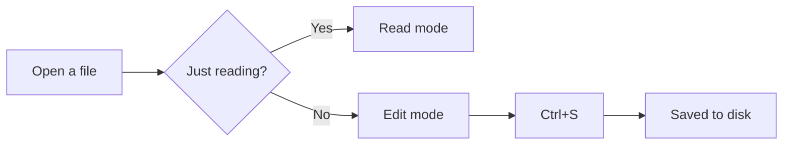
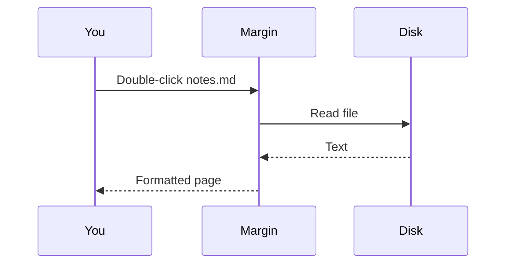

# Welcome to Margin

Margin is a notepad. Press `Ctrl` `N`, type, and close the window whenever you like. Everything you wrote is there next time, saved or not, even after a restart. Everything happens on your computer: no account, no ads, no internet needed.

This page is the tour. Scroll through it, then press `Ctrl` `E` and change anything you like. It is a scratch copy, so you can't break it.

## Nothing you type is lost

- **Closing the window never asks.** Every tab, including notes you never saved, is written to disk within a second or two of typing and comes back exactly where it was.
- **Only closing one tab asks** whether to save it, because that is the one time something could go away.
- **Changed your mind?** `Ctrl` `Shift` `T` reopens the last closed tab, unsaved text included.
- A note with no file yet is named after its first line, like Notepad. `Ctrl` `S` asks where to keep it.

## Any file, not just markdown

Open a `.txt`, `.log`, `.ini`, `.json` or any other text file and it shows as plain text, exactly as written, and saves back the same way, down to the encoding and line endings (both are in the bottom right, and both can be changed there). Code files get colour. Right-click any file in Explorer and choose **Edit with Margin**.

A plain text file that is really markdown? Press **Format as markdown** in the top right.

> [!TIP]
> `Win` `R`, type `note`, Enter: Margin opens, ready for a new note.

## Three ways to look at markdown

| Mode | What it is for |
| :-- | :-- |
| **Read** | A clean page. No cursor, nothing to click by accident, and the file is never changed. |
| **Edit** | Type and the formatting snaps into place as you go. |
| **Source** | The raw markdown, for when you want to see exactly what is in the file. |

`Ctrl` `E` flips between Read and Edit, and `Ctrl` `/` shows the source. The switch in the top right does the same thing.

> [!TIP]
> Press `Ctrl` `K` anywhere to search every command, every open tab and your recent files. Type `#` first to jump to a heading.

## Type and it formats

In Edit mode, start a line with one of these and press space. The line changes shape straight away.

| You type | You get |
| :-- | :-- |
| `# ` up to `###### ` | A heading, level 1 to 6 |
| `> ` | A quote |
| `- ` or `* ` | A bullet list |
| `1. ` | A numbered list |
| `- [ ] ` | A checkbox |
| ```` ``` ```` | A code block |
| `---` | A divider |
| `/` on an empty line | A menu with tables, images, math and more |

Inside a sentence, wrap words to style them: `**bold**` becomes **bold**, `*italic*` becomes *italic*, `~strike~` becomes ~~strike~~, `==highlight==` becomes ==highlight==, `` `code` `` becomes `code`, and `x^2^` becomes x^2^. Select any text to get a small toolbar with the same options.

## Lists and tasks

- Lists can nest
  - as deep as you need
    - and keep their shape
- Press `Tab` to indent and `Shift` `Tab` to go back

1. Numbered lists count for you
2. Add a line in the middle and the rest renumber

Checkboxes work in Read mode too. Click one:

- [x] Open Margin
- [x] Read the tour
- [ ] Pick a theme you like in Settings (`Ctrl` `,`)
- [ ] Open one of your own files

## Callouts

> A plain quote looks like this.

> [!NOTE]
> Files you only read are never rewritten. Margin saves only after you actually edit something.

> [!IMPORTANT]
> Unsaved changes show a dot on the tab and in the bottom left corner. They are kept safe until you save with `Ctrl` `S`.

> [!WARNING]
> If another program changes a file while you have unsaved edits here, Margin asks before replacing anything. That includes changes made while Margin was closed.

> [!CAUTION]
> Reloading from disk throws away your unsaved edits in that tab.

## Code

Code blocks are highlighted, and each one has a Copy button in its top right corner.

```python
def reading_time(words: int, per_minute: int = 230) -> str:
    minutes = max(1, round(words / per_minute))
    return f"{minutes} min read"
```

```rust
fn is_markdown(path: &std::path::Path) -> bool {
    matches!(
        path.extension().and_then(|e| e.to_str()),
        Some("md" | "markdown" | "mdx")
    )
}
```

```ts
type Mode = 'read' | 'edit' | 'source';
const next = (mode: Mode): Mode => (mode === 'read' ? 'edit' : 'read');
```

## Math

Write LaTeX between dollar signs. Inline, like $e^{i\pi} + 1 = 0$, or on its own line:

$$
x = \frac{-b \pm \sqrt{b^2 - 4ac}}{2a}
$$

$$
\int_{-\infty}^{\infty} e^{-x^2}\,dx = \sqrt{\pi}
$$

$$
\begin{aligned}
(x + 3)(x - 1) &= x^2 - x + 3x - 3 \\
&= x^2 + 2x - 3
\end{aligned}
$$

$$
\begin{pmatrix} a & b \\ c & d \end{pmatrix}
\begin{pmatrix} x \\ y \end{pmatrix}
=
\begin{pmatrix} ax + by \\ cx + dy \end{pmatrix}
$$

## Diagrams

A code block marked `mermaid` is drawn as a diagram.





## More things it understands

Tables can align columns:

| Left | Centre | Right |
| :--- | :---: | ---: |
| apples | 12 | $3.40 |
| pears | 7 | $2.15 |
| plums | 30 | $6.00 |

Footnotes keep asides out of the way.[^1] Emoji shortcodes work :rocket:. Bare links like https://commonmark.org become clickable. Keyboard keys can be marked up: <kbd>Ctrl</kbd> + <kbd>K</kbd>. Chemistry works with a little HTML: H<sub>2</sub>O.

Term
: A definition list puts an explanation under a word.

<details>
<summary>Click to expand</summary>

Hidden sections work too.

</details>

## Shortcuts worth knowing

| Shortcut | Does |
| :-- | :-- |
| `Ctrl` `N` or `Ctrl` `T` | New note |
| `Ctrl` `Alt` `N` | New plain text note |
| `Ctrl` `O` | Open a file |
| `Ctrl` `S` | Save |
| `Ctrl` `W` | Close the tab |
| `Ctrl` `Shift` `T` | Reopen the last closed tab |
| `Ctrl` `1` to `Ctrl` `9` | Jump to a tab (`9` is the last one) |
| `Ctrl` `Tab` | Next tab |
| `Ctrl` `E` | Switch between Read and Edit |
| `Ctrl` `K` | Command palette |
| `Ctrl` `F` and `Ctrl` `H` | Find, and find and replace |
| `Ctrl` `G` | Go to line |
| `F5` | Insert the time and date |
| `Alt` `Z` | Word wrap on or off |
| `Ctrl` `B` | Show or hide the sidebar |
| `Ctrl` `,` | Settings |
| `Ctrl` `=` and `Ctrl` `-` | Zoom |
| `Ctrl` `P` | Print or save as PDF |
| `F11` | Focus mode: just the page |

The full list is in Settings under Shortcuts.

---

That's the tour. Close this tab with `Ctrl` `W` whenever you like; you can bring it back from the command palette.

[^1]: Like this one. Click the arrow to jump back.
